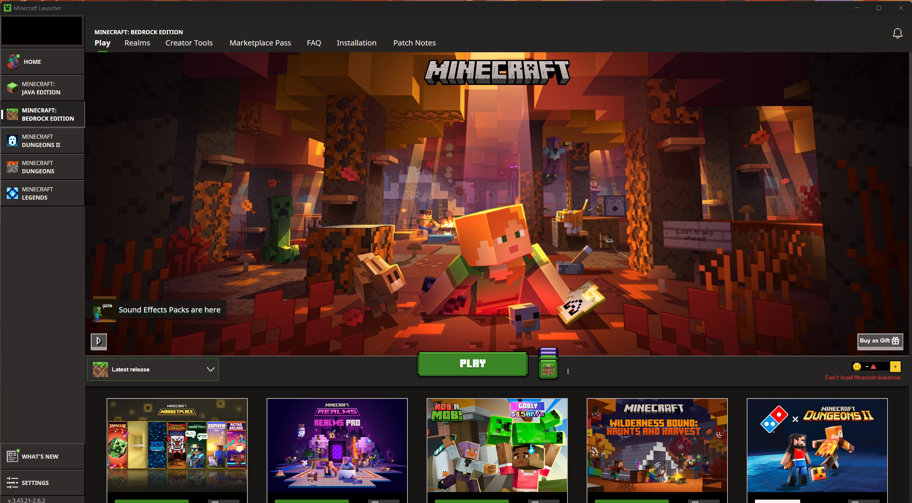
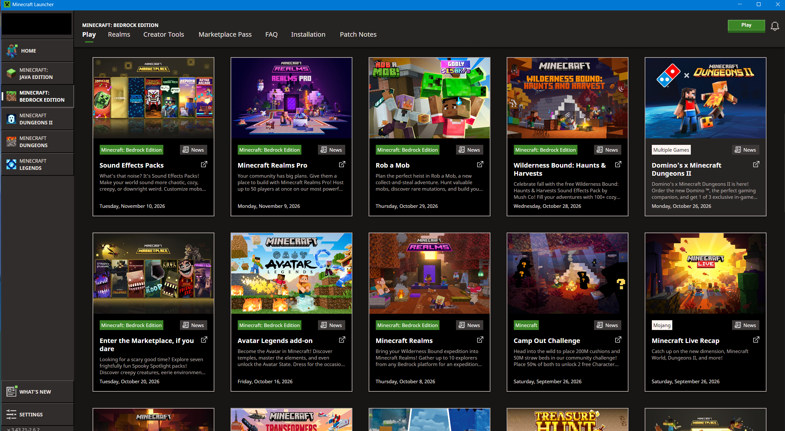
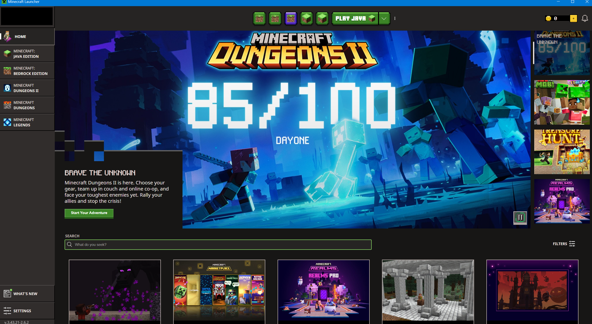
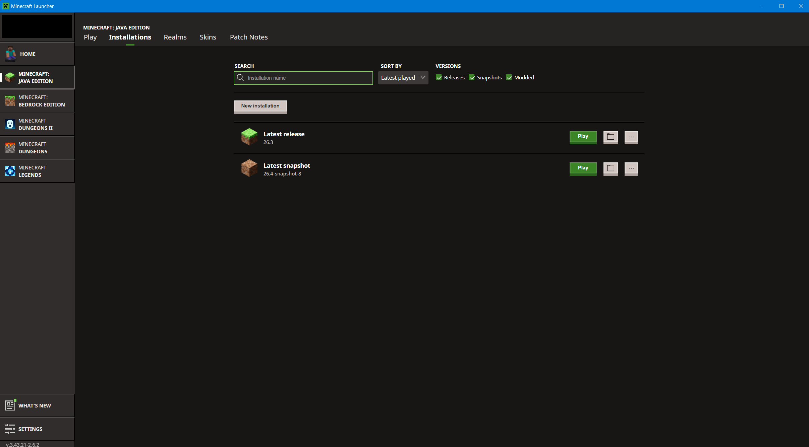
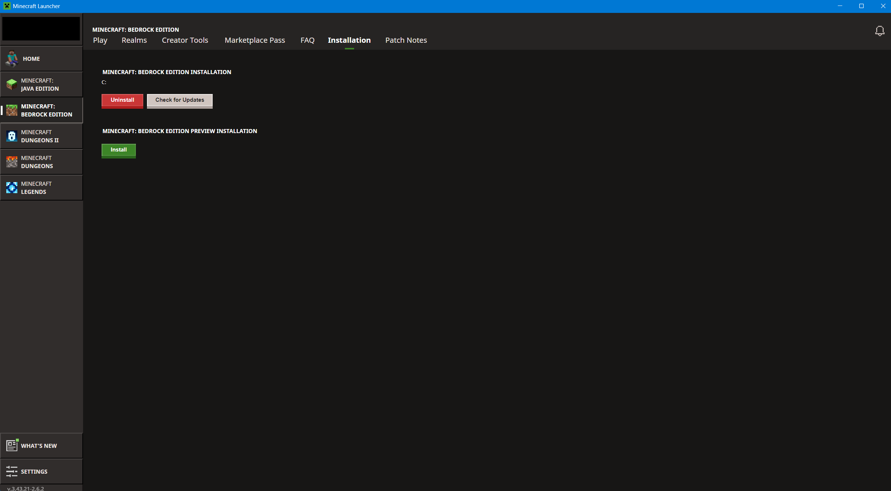

# The Many Failings of The Minecraft Launcher

I love playing video games. I used to play hours upon hours when I was younger. I would procrastinate on homework in favor of playing a shiny new game I bought for my PC. But there was one game that I always went back to, Minecraft. While I am not going to describe this game as that isn't my focus today, just know that it is the most sold game in the world, followed by Tetris. I personally use Prism Launcher for all my Minecraft needs, but I wanted to take another look at the default launcher.

What is a launcher? Simply put, it is an application used to boot up a game or service for you. Popular examples being Steam, Battle.net, and the Epic Games Launcher. Minecraft naturally has its own. Personally, I use game launcher to manage game versions, game files, and even mods (modifications) to the game I am playing.

Lets do a simple scenario with the Minecraft Launcher. I will assume you are already have the launcher download and signed in with your Minecraft account and you just want to play casually. Open up the application, which takes 18 seconds to load, click on the appropriate game, then click play. Simple. That is the **Mental Model** that I had and it matched with the **Conceptional Model** of the application.

Ok, so the launcher works, but what are all these buttons? The **Visual Design** is pretty nice. The color scheme is great, having quick play buttons is a nice addition, and having all modern day Minecraft franchise games in the launcher is plus. But, if I scroll down a bit, I find advertisements? While the concept is not foreign at all for game launchers to have news or advertisements related to their products, the amount is a lot to take in

Looking past the ads though, I found another issue. The Home page. It is a confusing mess. You have quick play buttons at the top, but below is a giant banner related to a different game than the quick play buttons. There is more news articles and advertisements, many of which are the same as the previously shown ones. This page feels redundant and I dont see anyone ever clicking on it.

With that aside, the launcher works, so why don't I use it? Simple, its lack of **Accessibility**. I like the ability to customize my game. I like switching between different versions, modifying the game contents, and easy access to my game files. While the launcher has the ability to switch game versions, this is limited to Minecraft Java Edition. All other games in the launcher do not have this feature. There is also no clear way to modify the game from the outside. Java requires you download software from third party (third party meaning people not affiliated with Mojang or Microsoft in this case) and Bedrock has everything through the Marketplace. The button to the games files is also hidden behind the three dots in the installations for Java, but there isnt any for any of the other games

All in all, the Minecraft Launcher is sound for very basic use. If you are like me and want to expand upon the game, this launcher is not for you.
